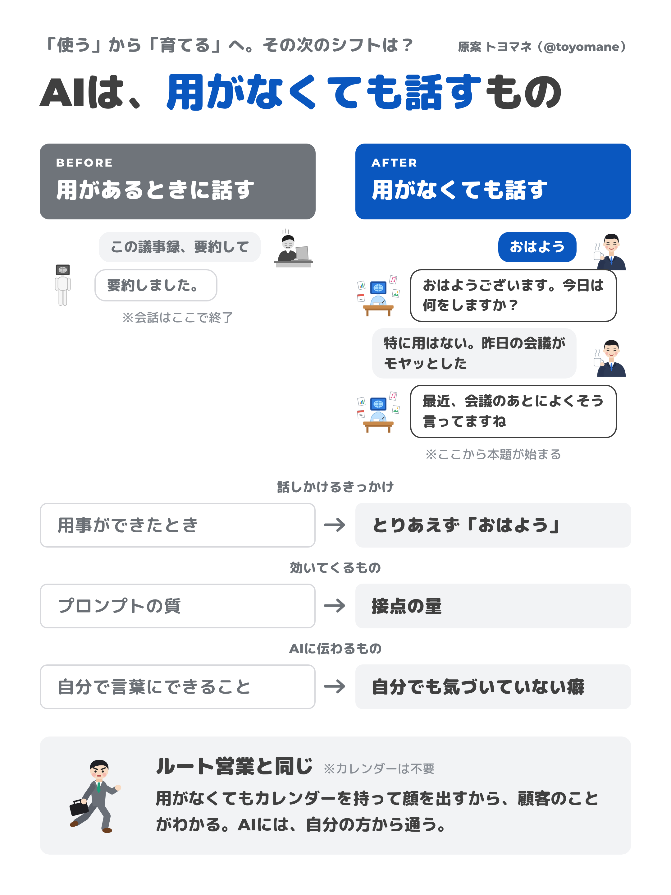
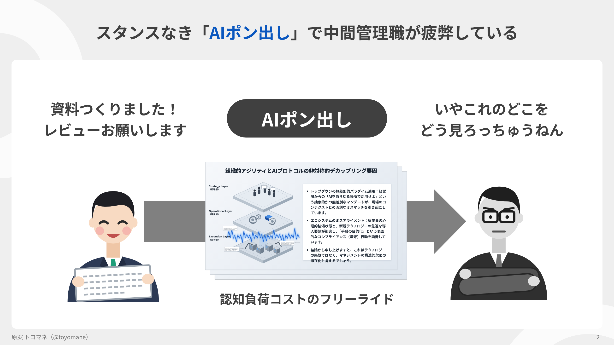

# 図解を作り直して学んだ小ネタ集

zukai 開発メモ
Claude Code との作業の記録

---

## この発表について

- トヨマネさんの図版を、Claude Code で作り直した
  - 縦長の図解 1 枚と、作り方を説明したスライド 2 枚
  - 記事「AIでゴミを量産する人になるな」の図版 8 枚
- 作り直す途中で見つけた小ネタを 3 つ話す

---

## 目次

1. 予備知識：zukai の作り
2. 小ネタ 1：寸法は文字幅から逆算する
3. 小ネタ 2：崩れは目ではなく検査で見つける
4. 小ネタ 3：いらすとやは手元に取ってくる

---

## 背景

- 元の図版は画像だけで、元データはない
- 同じ見た目を、文字を差し替えられる形で作り直したい
  - 自分の資料に使い回したい
  - 文字が増えても崩れないでほしい

見た目を真似るだけなら簡単だった。型として使えるかは、まったく別の話だった。

---

## 予備知識：ファイルの置き場所

```text
zukai/
├── build.js        縦長の図解と、作り方スライド
├── deck.js         記事の図版（8 種類の型）
├── check.js        崩れの検査
├── stress.js       文字を増やして、崩れる倍率を測る
├── examples/       データ（JSON と Markdown）
└── out/            書き出した PNG
```

---

## 予備知識：データの書き方

```json
{
  "type": "compare",
  "title": "同じ提案でも、3CONの有無で結果が変わる",
  "heads": ["スキルがないと", "スキルがあると"]
}
```

- `type` でレイアウトを選ぶ
- `[[ ]]` で囲んだ語は青で強調する

---

## 予備知識：型の一覧

| 型 | 使いどころ |
| --- | --- |
| cover | 見出し画像 |
| statement | 青地に一言だけ置く |
| three | 3 つの要素を × でつなぐ |
| process | 工程を矢羽根で並べる |
| compare | 「ないと」「あると」を比べる表 |

---

## 小ネタ 1

## 寸法は文字幅から逆算する

---

## 元画像の文字幅から字の大きさを出す

- 元画像には寸法の情報がない
- 1 行の文字数と行の幅がわかれば、字の大きさが出る

```python
# 「AIは、用がなくても話すもの」が幅 839px に収まっている
chars = 13.4           # 「AI」は 1.4 文字ぶんとして数える
font_px = 839 / chars  # → 約 62.6px
```

---

## 測った値

| 部品 | 元画像からの推定 | 採用した値 |
| --- | --- | --- |
| タイトル | 62.6px | 64px |
| まとめ枠の本文 | 27.8px | 26.5px |
| タイトルの上の一行 | 27.6px | 27px |

色は画像の画素から直接とった。青は #0a57bf。

---

## 並べて比べる



---

## 小ネタ 2

## 崩れは目ではなく検査で見つける

---

## 目で見るだけでは見落とす

- 元画像と並べて「ほぼ同じ」と判断した
- 実際は、箇条書きが枠から 20px はみ出していた
  - 3 枚重ねた資料の、手前の 1 枚
  - 縮小した絵では気づけない

---

## 検査を自動にする

```bash
node zukai/check.js zukai/out/workslop/html
```

```text
OK    zukai/out/workslop/html/01-cover.html
NG    zukai/out/workslop/html/02-slop.html
      overflow 縦に20px  トップダウンの無差別的パラダイム適用
8 枚中 1 枚に問題
```

---

## 何を見ているか

| 種類 | 中身 |
| --- | --- |
| overflow | 大きさの決まった箱から文字があふれている |
| outside | 文字や絵が、スライドの外か下端のクレジットにかかっている |
| overlap | 別々に置いた文字同士が重なっている |
| orphan | 1〜2 文字だけが次の行に落ちている |

---

## 文字を増やしたら何倍で崩れるか

| 型 | 自動縮小の前 | 自動縮小の後 |
| --- | --- | --- |
| compare | 1.25 倍で崩れる | 1.5 倍まで持つ |
| three | 1.25 倍で崩れる | 1.25 倍まで持つ |
| 縦長の図解 | 1.25 倍で崩れる | 1.25 倍まで持つ |

2 倍にすると、どの型も崩れる。そこから先は削るか、分けるしかない。

---

## 小ネタ 3

## いらすとやは手元に取ってくる

---

## 規約で効いてくる 3 つ

- 素材の再配布は、加工の有無にかかわらず禁止
- 商用なら 1 つの作品に 20 点まで
  - 同じ絵の重複は 1 点と数える
- 加工は、いらすとやの絵だとわかる範囲なら可

だから絵はリポジトリに入れず、使う人の手元に取ってくる。

---

## 取ってきて差し替える

```bash
node zukai/fetch-irasutoya.js   # 7 点を zukai/assets/ に取得
node zukai/deck.js              # assets/ の絵があれば自動で使う
```



---

## いらすとや版との比較


---

## ありがとうございました


